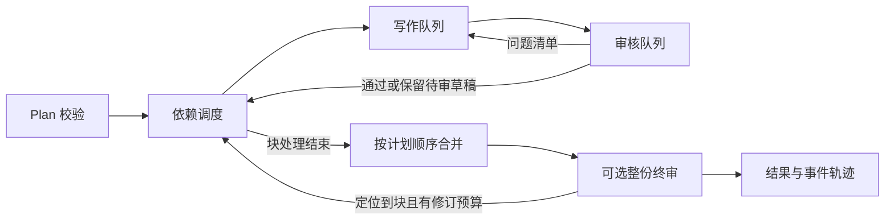

# 架构与状态契约

想先看实际运行，可从[维护通知实例](first-example.md)进入；本页记录引擎的通用数据结构与状态规则。

## 数据流

`Plan` 的块顺序决定输出顺序；依赖图决定何时可生成。依赖必须存在且无环。独立块可以提前进入写作队列；写作与审核是分别运行的工作者。审核退回会把同一个块的新版本重新放入**写作队列**，生成完成后再进**审核队列**；重写任务优先于尚未开始的普通生成任务。工作者数量由 `Policy` 决定，默认各一个。`written`、`reviewed` 和对应队列等待时间均包含重写轮次，`rewrites` 只是其中重新入队的次数，不是第三条队列。

## 契约

`Policy.scheduling` 默认 `overlap`；`serial` 是使用相同流程的逐块写审对照。真实模型与受控对照见[流程研究](../research/workflow-study.md)。

引擎在每次块生成前冻结直接依赖的正文、版本、状态、意见和 `uncertain` 标志，保存为 `BlockState.dependencies`。写作器与块审通过 `context.chunkloop_dependencies` 读取同一内容的独立副本；`passed` 参数继续传递依赖正文以兼容现有写作器。上游待审或继承了不确定性时，标志继续向下游传播；这只提供信息，不保证模型采纳。新快照随检查点恢复，旧检查点缺少此字段时只能提供空快照。

终审通过 `context.chunkloop_blocks` 获取块 ID、指令和状态，并可用 `Issue.block_ids` 定位问题。`Policy.max_final_revisions` 默认 1、设为 0 时只读终审；预算按每次 `Engine.run` 计数。只有全部意见均能定位到已知块时才自动修订，目标块收到原意见，其全部下游重做，其他块复用。随后重新合并和终审；本轮调用的指标累计所有修订，事件保留每轮经过。恢复运行会开始新的调用预算。

| 类型 | 作用 |
|---|---|
| `Block` | ID、指令、依赖 ID、允许的证据 ID |
| `Issue` / `Review` | 审核问题及通过判定；空问题集为通过 |
| `BlockState` | 状态、版本、重写次数、当前内容及问题 |
| `State` | 所有块的状态和事件轨迹 |
| `RunResult` | `completed`、`needs_review` 或 `blocked`，以及输出、意见、错误和指标 |

主状态流为 `pending → generating → reviewing → passed`；审核提出问题时回到 `pending` 重写。默认达到重写预算后进入 `needs_review`，保留草稿与问题；下游可继续使用该草稿，但最终结果会标明仍需人工审阅。显式严格审核时，未解决的问题才进入 `blocked`，不合并结果。`completed` 只表示处理结束且模型未提出未解决意见，不等于用户已接受或内容可直接发布。保存检查点时可能出现 `generating` 或 `reviewing`；恢复时前者重新生成，后者使用已保存的内容重新审核。

每个生成任务带版本号。调度器在消费结果时再次比对版本，过期结果只写入 `stale_result` 事件，不覆盖当前状态。检查点以临时文件加原子替换保存，包含计划、上下文和证据的哈希；普通恢复遇到输入变化会拒绝。显式 `rebase` 对比每块的指令、依赖和证据子集，重置变化块及其全部下游；通用上下文变化时全部失效。也可以用 `invalidate` 主动指定重做范围。

## 安全与故障边界

- 写作器和审核器收到的是该块 `evidence_ids` 指定的证据子集；调用方应避免把未授权证据再次塞进通用 `context`。
- 审核问题是结构化数据，审核器不能直接改写正文。默认审核意见作为反馈返回；模型调用异常和显式设置的超时属于执行错误，仍会阻断。
- 有限修订后仍未解决或无法定位的整份终审意见随草稿返回 `needs_review`；严格审核时返回 `blocked`。执行错误始终报告为 `blocked`；整篇修订执行失败时可返回上一轮草稿，必须结合错误与状态读取。
- 同步合并器由调用方提供；它应是确定性且快速的函数。持久化要求输入、内容及事件均可 JSON 序列化。
- 当前 JSON 检查点适合单进程运行；多进程抢占同一检查点需要外部锁或数据库后端。
- 样例任务可自行写入字数、证据或格式要求；引擎没有全局字数限制，也不会把模型的主观意见自动当作发布禁令。

## 从原项目抽取的关系

保留了双队列、块版本、审核回流、依赖、首块与队列耗时指标、已通过块复用等设计；把原业务的强制审核门禁改成显式可选策略。华为产品事实、营销合规、图片、软文首尾结构、网页工作台和知识库治理没有进入核心包。
