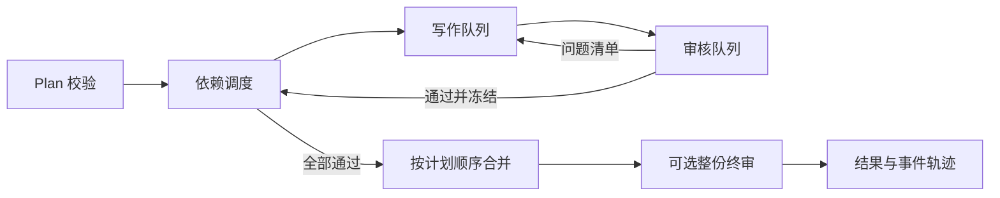

# 架构与状态契约

## 数据流

`Plan` 的块顺序决定输出顺序；依赖图决定何时可生成。依赖必须存在且无环。独立块可以提前进入写作队列；写作与审核是分别运行的工作者。重写任务优先于尚未开始的普通生成任务。工作者数量由 `Policy` 决定，默认各一个。

## 契约

| 类型 | 作用 |
|---|---|
| `Block` | ID、指令、依赖 ID、允许的证据 ID |
| `Issue` / `Review` | 审核问题及通过判定；空问题集为通过 |
| `BlockState` | 状态、版本、重写次数、当前内容及问题 |
| `State` | 所有块的状态和事件轨迹 |
| `RunResult` | `completed` 或 `blocked`、输出、错误和指标 |

主状态流为 `pending → generating → reviewing → passed`；审核不通过时回到 `pending`，达到上限则 `blocked`。保存检查点时可能出现 `generating` 或 `reviewing`。恢复时前者重新进入生成，后者使用已保存的内容重新审核。生成输出只有在审核通过后才供依赖块读取。

每个生成任务带版本号。调度器在消费结果时再次比对版本，过期结果只写入 `stale_result` 事件，不覆盖当前状态。检查点以临时文件加原子替换保存，包含计划、上下文和证据的哈希；普通恢复遇到输入变化会拒绝。显式 `rebase` 对比每块的指令、依赖和证据子集，重置变化块及其全部下游；通用上下文变化时全部失效。也可以用 `invalidate` 主动指定重做范围。

## 安全与故障边界

- 写作器和审核器收到的是该块 `evidence_ids` 指定的证据子集；调用方应避免把未授权证据再次塞进通用 `context`。
- 审核问题是结构化数据，审核器不能直接改写正文。超出重写上限、模型异常或超时会阻断结果。
- 合并仅在每块通过后执行。整份终审可发现跨块矛盾；终审失败时结果为 `blocked`。
- 同步合并器由调用方提供；它应是确定性且快速的函数。持久化要求输入、内容及事件均可 JSON 序列化。
- 当前 JSON 检查点适合单进程运行；多进程抢占同一检查点需要外部锁或数据库后端。

## 从原项目抽取的关系

保留了双队列、块版本、审核回流、依赖、上限阻断、首块与队列耗时指标、已通过块复用等设计；重新定义了业务无关的数据类型和适配器。华为产品事实、营销合规、图片、软文首尾结构、网页工作台和知识库治理没有进入核心包。
