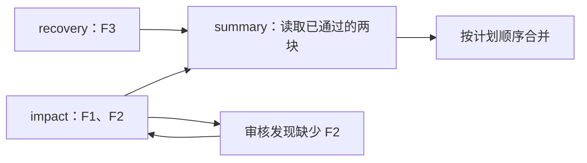

# 一个最小实例：维护通知

这个实例使用虚构事实，展示 ChunkLoop 已经完成的基本流程：按证据写块、指出遗漏、只重写有问题的块、等待依赖并合并成稿。运行 [`examples/maintenance_notice.py`](../examples/maintenance_notice.py) 不需要模型服务或密钥。

## 输入与计划

| 证据 ID | 示例事实 | 分配给 |
| --- | --- | --- |
| F1 | 22:00—22:30 | `impact` |
| F2 | 文件上传暂不可用 | `impact` |
| F3 | 维护结束后自动恢复，无需用户操作 | `recovery` |

`impact` 负责维护时间和影响，`recovery` 负责恢复方式；`summary` 依赖两者的通过内容。这个例子故意让 `impact` 第一版漏写 F2，以便看到审核回流。审核器使用字符串包含检查，缺哪条事实就返回带证据 ID 的 `Issue`。



## 运行与观察

在仓库根目录执行（Python 3.10+）：

```powershell
python -m examples.maintenance_notice
```

本地运行得到：

```text
状态：completed
审核轨迹：
  impact 第 1 版退回：缺少 F2：文件上传暂不可用
  recovery 第 1 版通过
  impact 第 2 版通过
  summary 第 1 版通过
成稿：
服务将在22:00—22:30维护，届时文件上传暂不可用。
文件上传功能将在维护结束后自动恢复，无需用户操作。
如需上传文件，请在维护结束后再试。
```

能直接核对的事实是：`impact` 写了两版，其他块各写一版；`summary` 在上游内容可用后写入；成稿按 `Plan` 顺序输出。运行中的 `completed` 表示这套确定性检查没有剩余问题。

## 实现位置

| 代码 | 做什么 |
| --- | --- |
| [`examples/maintenance_notice.py`](../examples/maintenance_notice.py) | 定义虚构输入、三块计划、写作器和事实审核器；打印事件与成稿。 |
| [`chunkloop/models.py`](../chunkloop/models.py) | 定义 `Block`、`Plan`、`Issue`、`Review`、`Policy` 等数据契约。 |
| [`chunkloop/engine.py`](../chunkloop/engine.py) | 调度写作与审核队列，限制证据范围，传递审核意见和依赖内容，按版本记录事件。 |

换成实际任务时，调用方提供事实和块计划，并按 `Writer.generate`、`Reviewer.review` 接口接入自己的生成与检查逻辑；需要模型时可参考 [`chunkloop/adapters.py`](../chunkloop/adapters.py)。引擎负责流程状态，事实是否真实、文案是否合适仍由输入来源和人工审核决定。

这个实例验证了接口与调度路径，没有评估真实模型的写作质量、速度或成本。已有真实模型尝试和遇到的问题见[验证记录](validation.md)。
